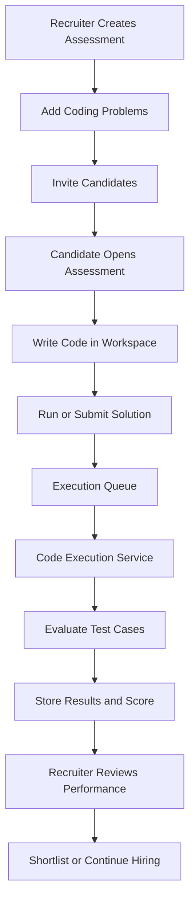
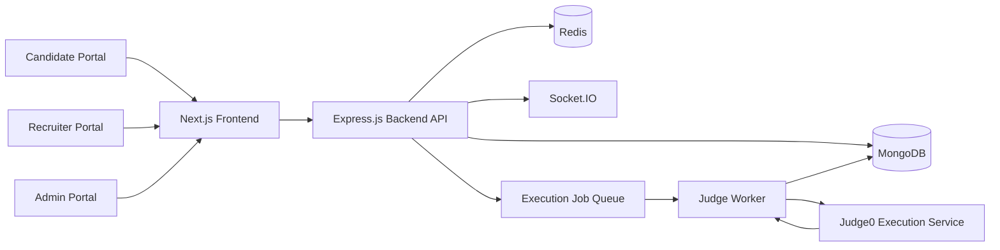

# ⚡ CodeArena — Code. Compete. Get Hired.

<p align="center">
  <strong>An Online Coding Assessment & Technical Hiring Platform</strong>
  <br />
  Helping companies evaluate coding skills and discover technical talent through real-world assessments.
</p>

<p align="center">
  
  
  
  
  
</p>

<p align="center">
  <a href="#-overview">Overview</a> •
  <a href="#-features">Features</a> •
  <a href="#-architecture">Architecture</a> •
  <a href="#-getting-started">Setup</a> •
  <a href="#-roadmap">Roadmap</a>
</p>

---

## 📌 Table of Contents

- [Overview](#-overview)
- [Why CodeArena?](#-why-codearena)
- [Features](#-features)
- [Platform Roles](#-platform-roles)
- [Assessment Workflow](#-assessment-workflow)
- [Architecture](#-architecture)
- [Tech Stack](#-tech-stack)
- [Getting Started](#-getting-started)
- [Environment Configuration](#-environment-configuration)
- [Project Structure](#-project-structure)
- [Security and Integrity](#-security-and-integrity)
- [Future Roadmap](#-roadmap)
- [Contributing](#-contributing)
- [Author](#-author)
- [License](#-license)

---

## 🚀 Overview

**CodeArena** is a web-based coding assessment and technical hiring platform designed to connect developers with recruiters through practical programming evaluations.

Instead of relying only on resumes or theoretical interviews, CodeArena provides a workflow where candidates solve coding problems, submit solutions, receive evaluation results, and optionally make their skills discoverable to recruiters.

Recruiters can create assessments, invite candidates, review performance, and manage hiring pipelines from a centralized workspace.

The platform is designed around three primary experiences:

- 👨‍💻 **Candidate Portal** — Solve challenges and track assessment performance.
- 🏢 **Recruiter Portal** — Create assessments, evaluate candidates, and manage hiring.
- 🛡️ **Admin Portal** — Manage platform users, review audit activity, and oversee operations.

> **Mission:** Turn demonstrated coding ability into meaningful career opportunities.

## 💡 Why CodeArena?

Traditional hiring often makes it difficult to evaluate practical programming ability consistently.

CodeArena aims to make technical evaluation more structured through:

- Practical, test-case-based coding assessments.
- Consistent scoring based on evaluation results.
- Candidate-controlled talent discoverability.
- A centralized assessment and application workflow.
- Integrity monitoring during online assessments.

## ✨ Features

### 👨‍💻 Candidate Experience

- Secure authentication and role-based access.
- Candidate profile and technical skill information.
- Assessment invitations and assessment workspace.
- Coding editor with language selection.
- Run and submit code for evaluation.
- Draft saving and assessment progress tracking.
- Submission history and evaluation status.
- Assessment score and result summaries.
- Optional talent discoverability and score sharing.
- Job applications and application status tracking.

### 🏢 Recruiter & Company Portal

- Company and team-oriented workspace.
- Create and manage coding assessments.
- Build assessments using programming problems.
- Invite candidates to assessments.
- Review candidate submissions and scores.
- Discover candidates who opt in to talent discovery.
- Filter talent using relevant skills and role information.
- Manage applications and hiring stages.
- Track candidates through the hiring pipeline.

### 🧑‍💼 Hiring Pipeline

Track candidates through structured stages:

`Applied → Screening → Assessment → Interview → Offer → Hired`

Applications can also be marked as `Rejected` when appropriate.

### ⚙️ Coding Evaluation Engine

- Multi-language code execution architecture.
- Test-case-based evaluation.
- Support for visible and hidden test cases.
- Execution status and result tracking.
- Background execution jobs and worker processing.
- Assessment score calculation based on evaluation results.
- Submission history for reviewing previous attempts.

Actual language availability and evaluation capabilities depend on the configured execution service and backend implementation.

### 🛡️ Assessment Integrity

CodeArena is designed with server-enforced assessment integrity rules:

| Violation | Intended response |
|---|---|
| First violation | Warning and event logging |
| Second violation | Final warning and event logging |
| Third violation | Assessment termination |

Potentially monitored events include:

- Copy, cut, and paste actions.
- Tab visibility changes.
- Window focus loss.
- Fullscreen exit events.

Violation counts should persist across refreshes and reconnections. These browser-based signals help identify suspicious activity but **cannot guarantee complete prevention of cheating or lock down a candidate's entire computer**.

### 🔔 Platform Administration

- User and platform management.
- Administrative overview.
- Audit activity review.
- Role-aware access controls.
- Operational monitoring and management tools.

Feature availability depends on the implemented and configured application modules.

---

## 👥 Platform Roles

| Role | Primary responsibilities |
|---|---|
| Candidate | Solve assessments, review results, manage profile |
| Recruiter | Create assessments, evaluate candidates, manage hiring |
| Company Admin | Manage company-level access and members |
| Platform Admin | Oversee users, audit activity, and platform operations |

Access to protected operations should be enforced by the backend, not just by hiding frontend pages.

---

## 🔄 Assessment Workflow



The intended workflow connects assessment creation, candidate participation, code execution, result storage, and recruitment decisions.

---

## 🏗️ Architecture



### Architectural responsibilities

- **Next.js:** Web interface and application routing.
- **Express.js:** APIs, authentication, business logic, and authorization.
- **MongoDB:** Persistent application, assessment, and submission data.
- **Redis:** Configured caching, queue, or temporary state operations.
- **Socket.IO:** Real-time communication where implemented.
- **Judge Worker:** Processes queued code execution jobs.
- **Judge0:** Executes submitted programs in a configured execution environment.

The exact data flow depends on the current backend configuration and deployed services.

---

## 🧰 Tech Stack

| Technology | Purpose |
|---|---|
| Next.js 15 | Frontend application |
| React & JavaScript/JSX | Interactive UI components |
| Tailwind CSS | Responsive styling |
| Node.js | Backend runtime |
| Express.js | REST API and middleware |
| MongoDB | Persistent data storage |
| Mongoose | MongoDB models and queries |
| Redis | Queue, cache, or temporary state support |
| Socket.IO | Real-time communication |
| Judge0 | Programming language execution |
| Git & GitHub | Version control and collaboration |

---

## 🖥️ Getting Started

Follow these steps to run the project locally.

### Prerequisites

Install the following tools before starting:

- Node.js and npm
- MongoDB instance or MongoDB Atlas connection
- Git
- Redis, if required by the enabled backend modules
- Judge0 service or a configured Judge0 API endpoint for code evaluation

### 1. Clone the repository

```bash
git clone YOUR_GITHUB_REPOSITORY_URL
cd CodeArena
```

Replace `YOUR_GITHUB_REPOSITORY_URL` with your actual repository URL.

### 2. Start the backend

```bash
cd backend
npm install
```

Create the backend `.env` file using the configuration described below.

Start the server using the script available in `backend/package.json`. For example:

```bash
npm run dev
```

If the project uses a different script, use the corresponding command from `package.json`.

### 3. Start the frontend

Open another terminal:

```bash
cd frontend
npm install
```

Create the frontend `.env.local` file.

Start the Next.js development server:

```bash
npm run dev
```

Open the local frontend at:

`http://localhost:3000`

If your backend uses port `5000`, its local base URL may be:

`http://localhost:5000`

Confirm the actual ports and scripts in your project configuration.

---

## 🔐 Environment Configuration

### Backend — `backend/.env`

Use the variable names expected by your existing backend implementation.

```env
NODE_ENV=development
PORT=5000

MONGODB_URI=your_mongodb_connection_string

JWT_SECRET=replace_with_a_secure_random_secret

REDIS_URL=redis://localhost:6379

JUDGE0_BASE_URL=your_judge0_api_url
JUDGE0_API_KEY=your_judge0_api_key
```

Some variables may not be required, or your existing code may use different names. Check the backend configuration before adding them.

### Frontend — `frontend/.env.local`

```env
NEXT_PUBLIC_API_URL=http://localhost:5000/api
```

Make sure the URL matches the API base URL used by your frontend API client.

**Security checklist**

- Never commit `.env` or `.env.local` files.
- Never expose JWT secrets or private API keys in frontend variables.
- Use strong, randomly generated secrets.
- Configure production environment variables through your hosting provider.
- Use HTTPS and secure cookie settings in production.

---

## 📁 Project Structure

The following is a conceptual overview. Adapt it to match your actual repository.

```text
CodeArena/
├── frontend/
│   ├── app/
│   ├── components/
│   ├── lib/
│   ├── public/
│   ├── package.json
│   └── .env.local
│
├── backend/
│   ├── controllers/
│   ├── middleware/
│   ├── models/
│   ├── routes/
│   ├── services/
│   ├── workers/
│   ├── utils/
│   ├── package.json
│   └── .env
│
├── .gitignore
└── README.md
```

Folder names may differ depending on the actual implementation.

---

## 🔒 Security and Integrity

Security is essential when handling coding assessments and candidate information.

CodeArena's security design should include:

- Server-side authentication and authorization.
- Role-based access to protected APIs.
- Password hashing and secure token handling.
- Input validation and controlled error responses.
- Protection of hidden test cases and evaluation details.
- Server-side assessment timers and submission validation.
- Persistent integrity-event tracking.
- Restricted execution of untrusted code through a suitable sandboxed judge.
- Rate limiting and appropriate production security headers.

**Important:** Never execute untrusted candidate code directly inside the main application server without proper isolation. Use a suitable sandboxed execution service.


---

## 🧪 Testing

Before releasing a new version, verify:

- Authentication and role permissions.
- Assessment creation and invitations.
- Valid and invalid code submissions.
- Multiple test cases and edge cases.
- Score calculation after evaluation.
- Pending, running, and failed execution states.
- Submission history and result persistence.
- Integrity violation limits.
- Protected API access and invalid requests.

---

## 🤝 Contributing

Contributions and constructive feedback are welcome.

1. Fork the repository.
2. Create a feature branch.
3. Implement and test your changes.
4. Commit with a clear message.
5. Open a pull request describing the changes.

Please avoid committing credentials, private assessment data, or sensitive test cases.

---

## 👩‍💻 Author

**Tannu Pal**

Full Stack Developer | Building practical web applications

CodeArena is a project focused on combining full-stack engineering, coding evaluation, secure backend workflows, and technical recruitment into one platform.

- GitHub: https://github.com/tannu01-dev/CodeArena

Replace these profile links with your actual profiles.

---

## 📄 License

Choose and add an appropriate open-source license before distributing this project publicly. Until a license is added, do not assume others have permission to reuse or redistribute the code.

---

<p align="center">
  <strong>CodeArena — Let skills speak through code. ⚡</strong>
  <br />
  <sub>Build. Evaluate. Discover. Hire.</sub>
</p>
